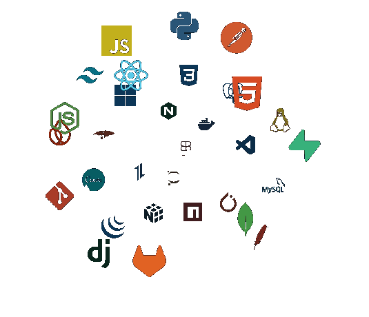

# 👨‍💻 Soren Shamlou | Backend Developer & Security Enthusiast

  

  
  

---

## 🧑‍💻 About Me

Hello! I'm **Soren Shamlou**, a passionate Backend Developer with a strong interest in software engineering, system architecture, and cybersecurity.

My journey in technology started with electronics and hardware programming, particularly C and embedded systems. I achieved **1st Place in a Line-Following Robot Competition**, which strengthened my problem-solving and engineering skills.

Today, my primary focus is Backend Development, especially building scalable, maintainable, and secure applications using Python and Django.

### 🚀 What I Do

- 🐍 Backend Development with Python & Django
- ⚙️ RESTful API Design and Development
- 🗄️ Database Design and Optimization
- 🔄 Asynchronous Processing with Celery & Redis
- 🐧 Linux Administration and Server Management
- 🔐 Cybersecurity and Penetration Testing
- 🛠️ Software Architecture and System Design

I enjoy exploring complex technical challenges, learning new technologies, and turning ideas into practical software solutions.

### 🏆 Featured Project

01. Soren VPN

<kbd>50K+ Users</kbd>

A VPN application available on Google Play, serving more than 50,000 users.

📱 View Soren VPN on Google Play

02. Soren VPN

<kbd>1M+ Downloads</kbd>

An Android VPN application with over one million downloads on Google Play.

📱 View Soren VPN – 1M+ Downloads

---

## 🧰 Tech Stack & Tools

### Programming Languages

  

### Backend & Development

  

### Databases

  

### DevOps, Systems & Security

  

### Frontend & Other Tools

  

---

## 📊 GitHub Statistics

  
  

  

---

## 🌐 Connect With Me

  
  
  
  
  

---

## 🔐 Security Notice

  <b>01001000 01100001 01100100 01101001 01110011</b>
   
  <i>Behind every great developer, there is someone special.</i>

---

## 🐧 Beyond Coding

  
  

---

  <i>"First, solve the problem. Then, write the code."</i>

